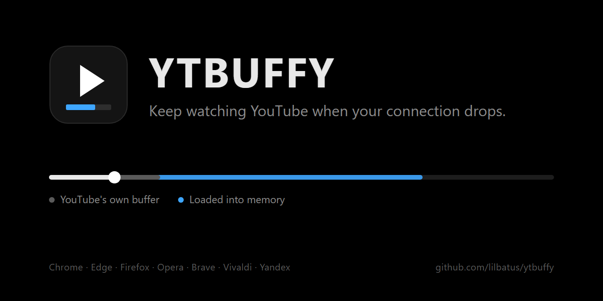

<p align="center">
  
</p>

<p align="center"><b>English</b> · <a href="README.tr.md">Türkçe</a></p>

# YTBUFFY

A Chrome extension that loads YouTube videos ahead into memory, so they keep playing when your connection drops.

YouTube's player only buffers two or three minutes ahead, which is not enough to get through an outage on a flaky connection. YTBUFFY keeps downloading the video in the background and feeds the player from memory, so playback carries on to the end of what has been loaded, whether the connection is up or not.

## Features

- **Plays through outages.** The video keeps going up to the end of the loaded part, and you can jump back and forth inside it.
- **Survives a reload.** Press F5 while offline and the video continues in the extension's own player, right where you left off.
- **Memory only.** Nothing is written to disk, and everything is gone when you close the tab.
- **No servers.** The extension only talks to YouTube, reusing the requests YouTube's own player makes. It never touches YouTube's signature or cipher code.
- **See what is loaded.** The loaded part is marked on the progress bar.
- **English and Turkish interface.**

## Installation

YTBUFFY is not on the Chrome Web Store, so you load it as an unpacked extension.

### From a release

1. Download the latest `ytbuffy-vX.Y.Z.zip` from [Releases](https://github.com/lilbatus/ytbuffy/releases) and extract it into a folder.
2. Open `chrome://extensions` and turn on **Developer mode** in the top right corner.
3. Click **Load unpacked** and select the extracted folder.
4. Refresh any YouTube tabs that were already open.

To update, extract the new release into the same folder, replacing the old files, and press the reload icon on the extension's card. Keeping the folder in the same place keeps your settings.

### From source

You need [Node.js](https://nodejs.org) 20 or later.

```bash
git clone https://github.com/lilbatus/ytbuffy.git
cd ytbuffy
npm install
npm run build
```

Then load the `dist` folder the same way. To update, pull the latest changes, run `npm run build` again and press the reload icon.

## Usage

Open a video and the extension gets to work on its own. The blue part on the progress bar is what is already in memory.

- **Popup:** turn the extension on or off, see how much of the video is loaded and how much memory it uses, and start, pause or resume loading.
- **Settings:** every option is explained on the page itself. Switch the interface language with **TR | ENG** in the top right corner. The [Docs](#docs) below go through each setting in more detail.

## How it works

YouTube's web player streams video with an undocumented protocol called SABR. YTBUFFY takes the player's own requests as a template and uses them to download the next parts of the video into memory. When the player asks for more, the answer comes straight from memory without touching the network, so a dropped connection goes unnoticed until the loaded part runs out.

## Docs

### Settings

The default value is shown next to each setting.

#### General

**Extension on** `on`\
Turns the whole extension on or off. When it is off, YouTube behaves exactly as it would without the extension, and the memory it used is freed right away.

**When loading starts** `when it starts playing`\
*When the video opens* starts loading right away, even if you never press play. *When it starts playing* waits until the video actually plays, so videos you only open for a moment cost no data. *Only with the button* loads nothing until you press **Start loading** in the popup, which is handy on a metered connection.

**Also on Shorts** `off`\
Shorts are short and usually swiped past within seconds, so loading them ahead mostly wastes data. Turn this on if you watch a lot of Shorts on a connection that keeps dropping.

**Live streams** `always off`\
A live stream is made as it airs, so there is nothing ahead to load. The extension stays out of the way on live streams.

#### Quality

**Quality lock** `off`\
Plays and loads every video in the quality you pick. When it is off, YouTube picks the quality as the video starts, and that quality then stays for the whole video, because YouTube cannot switch it while the video plays from memory. Lock a quality if you want the same one every time, or to control how much memory and data a video takes.

**If the video lacks that quality** `closest lower`\
Not every video comes in every quality. Pick the closest lower one to save memory and data, or the closest higher one for a sharper picture.

**Follow quality changes** `on`\
When you change the quality yourself from YouTube's gear menu, the part loaded in the old quality is dropped and loading starts over in the new one from where you are. Turn it off to keep watching in the loaded quality; your choice then only applies to parts that are not in memory yet.

#### Loading ahead

**How far ahead to load** `to the end of the video`\
*To the end of the video* loads everything. It takes the most memory and data, but covers an outage of any length. *A set number of minutes* only keeps the next few minutes ready and tops them up as you watch.

**Minutes to keep ready** `30`\
Shown with *a set number of minutes*. How much of the video past the point you are watching stays in memory. Pick more than your longest connection drop: if outages last up to three minutes, ten minutes leaves a comfortable margin.

**Pause between downloads (ms)** `50`\
How long the extension waits after each download before asking for the next part. 0 loads as fast as your connection allows, while higher values spread the downloads out and leave more bandwidth for everything else. Downloads always go one at a time, and if YouTube asks for a longer wait, it gets one.

**Keep loading while paused** `on`\
Loading carries on while the video is paused, which is useful when you pause on purpose to let a video load ahead. Turn it off to stop downloading whenever you pause.

**Jumping to a part not loaded yet** `keep what is loaded`\
Loading always continues from the new point. *Keep what is loaded* also holds on to everything loaded before the jump, so you can still jump back without a connection. *Clear it and load from the new point* frees that memory right away.

**Let the player buffer more too** `on`\
YouTube's player normally keeps two to three minutes in its own buffer. This lets it hold more, up to what the browser allows, as a second line of defense in case serving from memory fails for some reason. It uses the browser's video buffer, not the memory limit.

#### Memory

**Memory limit (MB)** `500`\
The most memory the loaded videos may use in one tab. Everything stays in RAM and is gone when you close the tab. The estimate shown right below the limit tells you roughly how much fits: 500 MB holds about 25 minutes of 1080p or 45 minutes of 720p.

**When the memory limit is reached** `both selected`\
What may be removed to make room, tried in this order:

1. Other videos you watched earlier in the same tab.
2. Parts of the current video you have already watched.

The part of the current video you have not watched yet is never removed, and a preloaded next video always gives way to the current one. If the selected steps do not free enough room, loading pauses until there is room again.

**When you open another video** `clear it`\
What happens to a video in memory when you open another one in the same tab, or a minute after you leave a video. *Clear it* frees the memory. *Keep recent videos* keeps the last few, so you can go back to them without a connection.

**Videos to keep** `2`\
Shown with *keep recent videos*. How many videos stay in memory, counting the one you are watching. They all share the memory limit, so the more you keep, the less room each one gets.

#### When the connection drops

**Keep playing after a page reload** `on`\
If you reload the page while offline, YouTube cannot load: you get either Chrome's error page or YouTube's own offline page. With this on, the extension opens its own simple player in that tab instead and continues the video where you left off, up to the end of what is loaded. Once the connection is back, one click takes you back to YouTube, and the loaded part comes along, so nothing has to be downloaded again.

To make this possible, the extension keeps a second copy of the loaded video in its own memory, so memory use can nearly double. The copy is still RAM only, never touches the disk and never goes over the memory limit.

**Let the copy drop what you have watched** `off`\
Shown while the option above is on. Saves memory by keeping only the last few minutes before the point you are watching in that copy. The trade-off: after a reload you can only rewind that far, and going back to YouTube means the older parts have to be downloaded again. When off, the copy keeps everything until the memory limit is reached.

**Minutes to keep behind you** `2`\
How much of the watched part the copy holds on to when the option above is on.

**Check interval (seconds)** `10`\
While offline, how often the extension checks whether the connection is back. The first check comes two seconds after a drop, and loading resumes the moment the connection returns.

**Connection notices** `on`\
Shows a short notice on the player when the connection drops, with how much can still play from memory, and another one when it comes back.

**Warn before the part in memory runs out (seconds)** `30`\
While offline, shows a notice this many seconds before playback reaches the end of the loaded part, so the stop does not take you by surprise. 0 turns the warning off.

#### Next video

**Load the next video too** `on`\
A few seconds before a video ends, YouTube starts loading the next one. From that moment the extension loads it into memory as well, so the next video can also play through an outage. This only helps if the connection drops after the switch, because YouTube cannot open a new page without a connection.

**Which video counts as next** `both (playlist first)`\
In a playlist, the next video is the next item in the list. Elsewhere, it is the video autoplay is about to open. Choose whether the extension should load either of them or only one kind.

**How much of the next video** `only the first minutes`\
*All of it* loads the whole next video and takes a lot of memory. *Only the first minutes* loads just its beginning, which is enough to bridge an outage right after the switch; the rest loads normally once you are watching it.

**Minutes from the start of the next video** `5`\
How much of the next video's beginning is loaded ahead when *only the first minutes* is selected.

#### Appearance

**Show what is in memory on the progress bar** `on`\
Colors the loaded part on YouTube's progress bar, on top of the grey part YouTube buffered itself, so you can see at a glance how far you can watch or jump without a connection.

**Color** `#3ea6ff`\
The color of that loaded part.

**Show the loaded percentage** `on`\
Shows how much of the video is in memory just above the progress bar while the player controls are visible.

**Notice when fully loaded** `on`\
Shows a short notice on the player once the whole video is in memory.

#### Advanced

**Debug mode** `off`\
Writes a detailed log to the browser console: open DevTools, go to Console and look for lines starting with `[ytbuffy]`. Turn it on when something does not work and you want to see why, or when you report a bug.

**Browser video buffer limit (MB)** `150` and **Browser audio buffer limit (MB)** `12`\
How much media Chrome lets one player buffer. Only *Let the player buffer more too* uses these values. Leave them as they are unless you start Chrome with the flags described [below](#a-bigger-player-buffer).

**Export settings** and **Import settings**\
Copy all your settings as text to keep them or move them to another computer, then paste them back later. Settings missing from the pasted text keep their current values.

**Restore defaults**\
Puts every setting back the way it was right after installing.

### Popup button

The button in the popup changes with the situation:

- **Start loading** when loading has not started yet, for example with *only with the button*.
- **Pause loading** while the extension is downloading. Pausing only stops downloads; whatever is already in memory keeps playing.
- **Resume loading** after a pause.

### The player after a reload

After a reload without a connection, the video opens in the extension's own player. You can seek within the loaded part, go fullscreen and use the usual shortcuts: Space or K to play and pause, J and L or the arrow keys to skip, F for fullscreen and M to mute. When the connection is back, **Back to YouTube** opens the same second on YouTube.

### A bigger player buffer

Chrome limits each player's buffer to 150 MB of video and 12 MB of audio. Playing from memory is not affected by this, but *Let the player buffer more too* is. To raise the limits, start Chrome with these flags while it is fully closed:

```
chrome.exe --mse-video-buffer-size-limit-mb=1024 --mse-audio-buffer-size-limit-mb=96
```

Then enter the same values under **Advanced**.

### Memory Saver

If Chrome's Memory Saver discards a background tab, the memory that tab used goes with it. To prevent this, add `youtube.com` to **Always keep these sites active** at `chrome://settings/performance`.

## Privacy

- Video data lives only in memory and is never written to disk.
- Nothing is sent anywhere except to YouTube itself.
- Settings are kept locally with `chrome.storage.local` and are not synced.

The extension asks for three permissions: `storage` for your settings, `offscreen` for the copy kept for page reloads, and `webNavigation` to notice a reload that failed because the connection is down.

## Limitations

- Live streams are not supported.
- You cannot switch to another video while offline, because YouTube cannot open a new page without a connection.
- The player that opens after a reload is not the YouTube page, so there are no comments, suggestions or captions there.
- SABR is undocumented. If YouTube changes it, the extension may stop working until it is updated.
- Built and tested on Chrome 156.

## Development

```bash
npm test        # unit and flow tests
npm run build   # builds the extension into dist/
npm run watch   # rebuilds on every change
```

| Folder | What is inside |
| --- | --- |
| `src/page` | The core that runs inside the YouTube page: request hooks, SABR and UMP parsing, the memory cache, loading ahead and serving from memory |
| `src/content` | The bridge to the extension and the overlays on the player |
| `src/background` | The service worker that opens the player after a failed reload |
| `src/vault` | The offscreen document that keeps the copy for page reloads |
| `src/replay` | The player that opens after a reload |
| `src/popup`, `src/options` | The popup and the settings page |
| `src/shared` | Settings, the interface text in both languages and a few shared functions |
| `static` | The manifest, HTML, CSS and icons |

## License

YTBUFFY is released under the [GNU Affero General Public License v3.0](LICENSE).


## Disclaimer

This software is provided "as is", without warranty of any kind, express or implied.
- **Educational & Research Use:** This project is intended solely for educational purposes, personal experimentation, and understanding browser extension architecture.
- **Compliance:** The author does not endorse or encourage any violation of third-party terms of service, platform guidelines, or copyright policies. Users are entirely responsible for their own use of this software.
- **Limitation of Liability:** In no event shall the author be held liable for any claims, damages, or liabilities arising from the use or distribution of this software.