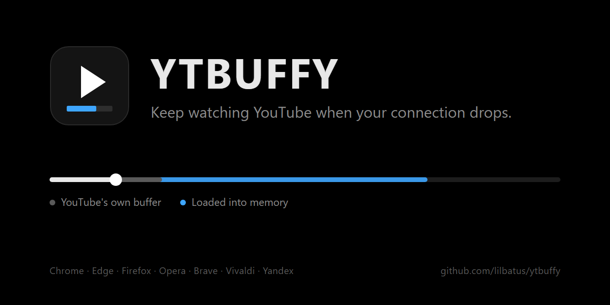

<p align="center">
  
</p>

<p align="center"><a href="README.md">English</a> · <b>Türkçe</b></p>

# YTBUFFY

YouTube videolarını önceden belleğe yükleyen bir tarayıcı eklentisi. Bağlantın koptuğunda video oynamaya devam eder. Chrome, Edge, Firefox, Opera, Opera GX, Brave, Vivaldi ve Yandex Browser'da çalışır.

YouTube oynatıcısı yalnızca iki üç dakika ilerisini yükler; bağlantısı sık sık kopan biri için bu bir kesintiyi atlatmaya yetmez. YTBUFFY videoyu arka planda indirmeye devam eder ve oynatıcıyı bellekten besler. Böylece bağlantı olsa da olmasa da video, yüklenen kısmın sonuna kadar oynar.

## Özellikler

- **Kesintilerde oynamaya devam eder.** Video yüklenen kısmın sonuna kadar sürer, bu kısım içinde ileri geri de sarabilirsin.
- **Sayfa yenilense de durmaz.** Bağlantı yokken F5'e basarsan video eklentinin kendi oynatıcısında kaldığın yerden devam eder.
- **Yalnızca bellek.** Diske hiçbir şey yazılmaz; sekmeyi kapatınca her şey silinir.
- **Sunucu yok.** Eklenti yalnızca YouTube ile konuşur ve YouTube oynatıcısının kendi yaptığı istekleri kullanır. YouTube'un imza ve şifreleme koduna hiç dokunmaz.
- **Neyin yüklendiğini görürsün.** Yüklenen kısım ilerleme çubuğunda işaretlenir.
- **İngilizce ve Türkçe arayüz.**

## Kurulum

YTBUFFY hiçbir eklenti mağazasında yok; hazır sürümden kurulur. [Son sürüm](https://github.com/lilbatus/ytbuffy/releases/latest) sayfasında her tarayıcının kendi dosyası var, yalnızca kendi tarayıcının dosyasını indirmen yeterli:

| Tarayıcı | Dosya |
| --- | --- |
| Google Chrome | `ytbuffy-chrome-vX.Y.Z.zip` |
| Microsoft Edge | `ytbuffy-edge-vX.Y.Z.zip` |
| Mozilla Firefox | `ytbuffy-firefox-vX.Y.Z.zip` |
| Opera | `ytbuffy-opera-vX.Y.Z.zip` |
| Opera GX | `ytbuffy-operagx-vX.Y.Z.zip` |
| Brave | `ytbuffy-brave-vX.Y.Z.zip` |
| Vivaldi | `ytbuffy-vivaldi-vX.Y.Z.zip` |
| Yandex Browser | `ytbuffy-yandex-vX.Y.Z.zip` |

### Chrome, Edge, Opera, Opera GX, Brave, Vivaldi ve Yandex Browser

1. Zip'i saklayacağın bir klasöre çıkar. Tarayıcı eklentiyi bu klasörden yükler; sonradan silme ya da yerini değiştirme.
2. Aşağıdaki tablodan tarayıcının eklentiler sayfasını aç ve **Geliştirici modu**nu aç.
3. Tablodaki yükleme düğmesine tıkla ve çıkardığın klasörü seç. İngilizce arayüzde bu düğmenin adı her tarayıcıda **Load unpacked**.
4. Açık olan YouTube sekmelerini yenile.

| Tarayıcı | Eklentiler sayfası | Geliştirici modu anahtarı | Yükleme düğmesi |
| --- | --- | --- | --- |
| Chrome | `chrome://extensions` | sağ üstte | **Paketlenmemiş öğe yükle** |
| Edge | `edge://extensions` | sol kenar çubuğunun altında | **Açılmışı yükle** |
| Opera | `opera://extensions` | sağ üstte, arama kutusunun yanında | **Paketlenmemiş öge yükle** |
| Opera GX | `opera://extensions` | sağda, eklenti listesinin hemen üstünde | **Paketlenmemiş öge yükle** |
| Brave | `brave://extensions` | sağ üstte | **Paketlenmemiş öğe yükle** |
| Vivaldi | `vivaldi://extensions` | sağ üstte | **Paketlenmemişi Yükle** |
| Yandex Browser | `browser://extensions` | sağ üstte | **Paketlenmemiş öğe yükle** |

Güncellemek için yeni sürümü aynı klasöre, eski dosyaların üzerine çıkar ve eklentinin kartındaki yenile simgesine bas. Klasörün yerini değiştirmezsen ayarların korunur.

### Firefox

1. `about:debugging#/runtime/this-firefox` sayfasını aç.
2. **Geçici eklenti yükle…** (İngilizce arayüzde **Load Temporary Add-on…**) düğmesine tıkla ve indirdiğin zip'i seç. Zip'i çıkarman gerekmez.
3. Açık olan YouTube sekmelerini yenile.

Firefox'un normal sürümleri yalnızca Mozilla'nın imzaladığı eklentileri kalıcı olarak tutar. Bu yüzden Firefox kapanınca eklenti kaldırılır ve yeniden başlattıktan sonra tekrar yüklemen gerekir. Firefox Developer Edition, Nightly ve ESR ise eklentiyi kalıcı olarak tutabilir: `about:config` sayfasında `xpinstall.signatures.required` değerini `false` yap, zip'in adını `ytbuffy.xpi` olarak değiştir, sonra `about:addons` sayfasında dişli simgesine tıklayıp **Dosyadan eklenti yükle…** (İngilizce arayüzde **Install Add-on From File…**) ile onu seç.

### Kaynaktan derleyerek

[Node.js](https://nodejs.org) 20 veya daha yeni bir sürüm gerekir.

```bash
git clone https://github.com/lilbatus/ytbuffy.git
cd ytbuffy
npm install
npm run build
```

Bu komut her tarayıcıyı kendi klasörüne derler: `dist/chrome`, `dist/edge`, `dist/firefox` gibi. Kendi tarayıcının klasörünü yukarıdaki adımlarla yükle; Firefox'ta `dist/firefox` içindeki `manifest.json` dosyasını seç. Yalnızca bir tarayıcıyı derlemek için adını yaz, örneğin `npm run build -- firefox`. Güncellemek için son değişiklikleri çek, yeniden derle ve yenile simgesine bas.

## Kullanım

Bir video açtığında eklenti kendiliğinden çalışmaya başlar. İlerleme çubuğundaki mavi kısım, bellekte hazır olan bölümdür.

- **Popup:** eklentiyi aç ya da kapat, videonun ne kadarının yüklendiğini ve ne kadar bellek kullanıldığını gör, yüklemeyi başlat, duraklat ya da devam ettir.
- **Ayarlar:** her seçenek sayfanın kendisinde açıklanır. Arayüz dilini sağ üstteki **TR | ENG** ile değiştirebilirsin. Aşağıdaki [Dokümantasyon](#dokümantasyon) bölümü her ayarı daha ayrıntılı anlatır.

## Nasıl çalışır

YouTube'un web oynatıcısı videoyu belgelenmemiş bir protokol olan SABR ile çeker. YTBUFFY, oynatıcının kendi isteklerini şablon olarak alır ve videonun sonraki kısımlarını bunlarla belleğe indirir. Oynatıcı yeni bir parça istediğinde yanıt ağa hiç gitmeden doğrudan bellekten gelir. Bu yüzden bağlantı koptuğunda, yüklenen kısım bitene kadar oynatıcı bunu fark etmez.

## Dokümantasyon

### Ayarlar

Her ayarın varsayılan değeri adının yanında yazar.

#### Genel

**Eklenti açık** `açık`\
Eklentinin tamamını açar ya da kapatır. Kapalıyken YouTube eklenti hiç yokmuş gibi çalışır ve eklentinin kullandığı bellek hemen boşaltılır.

**Yükleme ne zaman başlasın** `oynamaya başlayınca`\
*Video açılınca* sen oynatmaya basmasan bile yüklemeyi hemen başlatır. *Oynamaya başlayınca* video gerçekten oynayana kadar bekler; böylece yalnızca bir anlığına açtığın videolar internet harcamaz. *Yalnızca butonla* seçeneğinde popup'taki **Yüklemeyi başlat**'a basana kadar hiçbir şey yüklenmez; kotalı bir bağlantıda işe yarar.

**Shorts'ta da çalışsın** `kapalı`\
Shorts kısa olduğu ve genelde birkaç saniyede geçildiği için önceden yüklemek çoğu zaman boşa internet harcar. Sık kopan bir bağlantıda çok Shorts izliyorsan aç.

**Canlı yayınlar** `her zaman kapalı`\
Canlı yayın o anda üretildiği için ileriden yüklenecek bir şey yoktur. Eklenti canlı yayınlara hiç karışmaz.

#### Kalite

**Kalite kilidi** `kapalı`\
Her videoyu seçtiğin kalitede oynatır ve o kalitede yükler. Kapalıyken kaliteyi video başlarken YouTube seçer ve video sonuna kadar o kalitede kalır; çünkü video bellekten oynarken YouTube kaliteyi değiştiremez. Her seferinde aynı kaliteyi istiyorsan ya da bir videonun ne kadar bellek ve internet harcayacağını kontrol etmek istiyorsan kalite kilitle.

**Videoda o kalite yoksa** `en yakın alt kalite`\
Her video her kalitede bulunmaz. Bellekten ve internetten tasarruf için en yakın alt kaliteyi, daha net görüntü için en yakın üst kaliteyi seç.

**Kalite değişikliğini takip et** `açık`\
Kaliteyi YouTube'un dişli menüsünden kendin değiştirdiğinde eski kalitede yüklenen kısım silinir ve yükleme bulunduğun yerden yeni kalitede yeniden başlar. Kapatırsan video yüklendiği kalitede oynamaya devam eder; seçtiğin kalite yalnızca henüz bellekte olmayan kısımlarda geçerli olur.

#### Önceden yükleme

**Ne kadar ileri yüklensin** `videonun sonuna kadar`\
*Videonun sonuna kadar* her şeyi yükler. En çok belleği ve interneti o harcar, ama ne kadar uzun sürerse sürsün her kesintiyi karşılar. *Belirli bir süre* yalnızca önündeki birkaç dakikayı hazır tutar ve izledikçe tamamlar.

**Hazır tutulacak dakika** `30`\
*Belirli bir süre* seçiliyken görünür. İzlediğin yerden itibaren videonun ne kadarının bellekte hazır tutulacağı. En uzun bağlantı kesintinden fazlasını seç: kesintiler en fazla üç dakika sürüyorsa on dakika rahat bir paydır.

**İndirmeler arası bekleme (ms)** `50`\
Eklentinin her indirmeden sonra sıradaki parçayı istemeden önce ne kadar bekleyeceği. 0, bağlantının izin verdiği en yüksek hızla yükler; daha yüksek değerler indirmeleri zamana yayar ve diğer işlerin için daha çok bant genişliği bırakır. İndirmeler her zaman tek tek yapılır; YouTube daha uzun beklenmesini isterse ona uyulur.

**Duraklatınca da yüklemeye devam et** `açık`\
Video duraklatılmışken de yükleme sürer. Bir videoyu önceden yüklensin diye bilerek durdurduğunda işe yarar. Kapatırsan video her duraklatıldığında indirme de durur.

**Henüz yüklenmemiş bir yere atlayınca** `yükleneni koru`\
Yükleme her durumda yeni noktadan devam eder. *Yükleneni koru* atlamadan önce yüklenen her şeyi de tutar, böylece bağlantı yokken geri dönebilirsin. *Temizle, yeni noktadan yükle* o belleği hemen boşaltır.

**Oynatıcı da daha fazlasını tutsun** `açık`\
YouTube oynatıcısı normalde kendi tamponunda iki üç dakika tutar. Bu ayar, tarayıcının izin verdiği kadar fazlasını tutmasını sağlar; bellekten oynatma bir sebeple çalışmazsa ikinci bir güvence olur. Bellek limitini değil, tarayıcının video tamponunu kullanır.

#### Bellek

**Bellek limiti (MB)** `500`\
Bir sekmede yüklenen videoların kullanabileceği en fazla bellek. Her şey RAM'de durur ve sekmeyi kapatınca silinir. Limitin hemen altındaki tahmin aşağı yukarı ne kadarının sığdığını gösterir: 500 MB'a yaklaşık 25 dakika 1080p ya da 45 dakika 720p video sığar.

**Bellek limiti dolunca** `ikisi de seçili`\
Yer açmak için nelerin silinebileceği; şu sırayla denenir:

1. Aynı sekmede daha önce izlediğin diğer videolar.
2. Şu anki videonun izlediğin kısımları.

Şu anki videonun henüz izlemediğin kısmı asla silinmez, önceden yüklenen sonraki video da her zaman şu anki videoya yer açar. Seçilen adımlar yeterli yer açmazsa yer açılana kadar yükleme durur.

**Başka bir video açınca** `temizle`\
Aynı sekmede başka bir video açtığında ya da bir videodan çıkıp bir dakika geçtiğinde bellekteki videoya ne olacağı. *Temizle* belleği boşaltır. *Son videoları tut* son birkaç videoyu saklar, böylece bağlantı yokken onlara geri dönebilirsin.

**Tutulacak video sayısı** `2`\
*Son videoları tut* seçiliyken görünür. İzlediğin video dahil bellekte kaç video kalacağı. Hepsi bellek limitini paylaşır; ne kadar çok video tutarsan her birine o kadar az yer düşer.

#### Bağlantı kopunca

**Sayfa yenilenince de oynatmaya devam et** `açık`\
Bağlantı yokken sayfayı yenilersen YouTube açılamaz; ya tarayıcının hata sayfası ya da YouTube'un kendi "İnternete bağlanın" sayfası gelir. Bu ayar açıkken eklenti o sekmede kendi sade oynatıcısını açar ve videoyu kaldığın yerden, yüklenen kısmın sonuna kadar oynatır. Bağlantı gelince tek tıkla YouTube'a dönersin; yüklenen kısım da seninle gelir, hiçbir şeyin yeniden indirilmesi gerekmez.

Bunu yapabilmek için eklenti yüklenen videonun ikinci bir kopyasını kendi belleğinde tutar, bu yüzden bellek kullanımı neredeyse iki katına çıkabilir. Kopya da yalnızca RAM'de durur, diske dokunmaz ve bellek limitini aşmaz.

**Kopya izlediğin kısımları bıraksın** `kapalı`\
Üstteki ayar açıkken görünür. Kopyada izlediğin yerin yalnızca son birkaç dakikasını tutarak bellekten tasarruf eder. Bedeli şu: sayfayı yeniledikten sonra yalnızca o kadar geri sarabilirsin, YouTube'a dönünce de daha eski kısımların yeniden indirilmesi gerekir. Kapalıyken kopya, bellek limiti dolana kadar her şeyi tutar.

**Geride tutulacak dakika** `2`\
Üstteki ayar açıkken kopyanın izlediğin yerden geriye doğru ne kadarını saklayacağı.

**Kontrol aralığı (saniye)** `10`\
Bağlantı yokken eklentinin bağlantının gelip gelmediğini ne sıklıkla kontrol edeceği. İlk kontrol bağlantı koptuktan iki saniye sonra yapılır; bağlantı gelir gelmez yükleme devam eder.

**Bağlantı bildirimleri** `açık`\
Bağlantı koptuğunda bellekten daha ne kadar oynatılabileceğini, geri geldiğinde de bunu oynatıcının üstünde kısa bir bildirimle gösterir.

**Bellekteki kısım bitmeden uyar (saniye)** `30`\
Bağlantı yokken oynatma yüklenen kısmın sonuna bu kadar saniye kala bir uyarı gösterir; böylece video durduğunda şaşırmazsın. 0 uyarıyı kapatır.

#### Sonraki video

**Sonraki videoyu da yükle** `açık`\
Bir video bitmeden birkaç saniye önce YouTube sıradakini yüklemeye başlar. O andan itibaren eklenti de onu belleğe alır; böylece sıradaki video da bir kesintiyi atlatabilir. Bu yalnızca bağlantı geçişten sonra koparsa işe yarar, çünkü bağlantı yokken YouTube yeni sayfayı açamaz.

**Hangi video sonraki sayılsın** `ikisi de (önce liste)`\
Oynatma listesinde sonraki video, listedeki bir sonraki videodur. Liste dışında ise otomatik oynatmanın açmak üzere olduğu videodur. Eklentinin ikisini de mi, yalnızca birini mi yükleyeceğini seç.

**Sonraki videonun ne kadarı** `yalnızca ilk dakikaları`\
*Tamamı* sonraki videonun hepsini yükler ve çok bellek harcar. *Yalnızca ilk dakikaları* sadece başını yükler; bu, geçişten hemen sonraki bir kesintiyi atlatmaya yeter. Videonun geri kalanı onu izlemeye başlayınca her zamanki gibi yüklenir.

**Sonraki videonun ilk kaç dakikası** `5`\
*Yalnızca ilk dakikaları* seçiliyken sonraki videonun başından itibaren ne kadarının önceden yükleneceği.

#### Görünüm

**Bellekteki kısmı ilerleme çubuğunda göster** `açık`\
Yüklenen kısmı YouTube'un ilerleme çubuğunda, YouTube'un kendi yüklediği gri kısmın üstünde renkli gösterir. Bağlantı yokken nereye kadar izleyebileceğini ya da atlayabileceğini bir bakışta görürsün.

**Renk** `#3ea6ff`\
Yüklenen kısmın ilerleme çubuğundaki rengi.

**Yüklenme yüzdesini göster** `açık`\
Oynatıcı kontrolleri görünürken videonun ne kadarının bellekte olduğunu ilerleme çubuğunun hemen üstünde gösterir.

**Tamamen yüklenince bildir** `açık`\
Videonun tamamı belleğe alındığında oynatıcının üstünde kısa bir bildirim gösterir.

#### Gelişmiş

**Debug modu** `kapalı`\
Tarayıcı konsoluna ayrıntılı log yazar: DevTools'u aç, Console sekmesine geç ve `[ytbuffy]` ile başlayan satırlara bak. Bir şey çalışmadığında nedenini görmek ya da hata bildirmek için aç.

**Tarayıcı video tampon sınırı (MB)** `150` ve **Tarayıcı ses tampon sınırı (MB)** `12`, Firefox'ta `20`\
Tarayıcının bir oynatıcıya izin verdiği en fazla video ve ses tamponu. Bu değerleri yalnızca *Oynatıcı da daha fazlasını tutsun* kullanır. Tarayıcının sınırlarını [aşağıda](#daha-büyük-bir-oynatıcı-tamponu) anlatıldığı gibi yükseltmediysen olduğu gibi bırak.

**Ayarları dışa aktar** ve **Ayarları içe aktar**\
Tüm ayarlarını metin olarak kopyalayıp saklayabilir ya da başka bir bilgisayara taşıyabilir, sonra geri yapıştırabilirsin. Yapıştırdığın metinde olmayan ayarlar şimdiki değerlerini korur.

**Varsayılana dön**\
Tüm ayarları kurulumdan hemen sonraki hâline döndürür.

### Popup butonu

Popup'taki buton duruma göre değişir:

- **Yüklemeyi başlat:** yükleme henüz başlamadıysa, örneğin *yalnızca butonla* seçiliyken.
- **Yüklemeyi duraklat:** eklenti indirme yaparken. Duraklatmak yalnızca indirmeyi durdurur; bellekte olan kısım oynamaya devam eder.
- **Yüklemeye devam et:** duraklattıktan sonra.

### Sayfa yenilendikten sonra açılan oynatıcı

Bağlantı yokken sayfayı yenilediğinde video eklentinin kendi oynatıcısında açılır. Yüklenen kısım içinde ileri geri sarabilir, tam ekrana geçebilir ve alışık olduğun kısayolları kullanabilirsin: oynatıp durdurmak için Boşluk ya da K, atlamak için J ile L ya da ok tuşları, tam ekran için F, sesi kapatmak için M. Bağlantı gelince **YouTube'a dön** videoyu YouTube'da aynı saniyeden açar.

### Daha büyük bir oynatıcı tamponu

Her oynatıcının tamponunu tarayıcı sınırlar: Chrome ve Chromium tabanlı diğer tarayıcılarda 150 MB video ve 12 MB ses, Firefox'ta 150 MB video ve 20 MB ses. Bellekten oynatma bundan etkilenmez, ama *Oynatıcı da daha fazlasını tutsun* etkilenir.

**Chrome, Edge, Opera, Opera GX, Brave, Vivaldi ve Yandex Browser.** Tarayıcıyı tamamen kapat, sonra şu bayraklarla başlat:

```
--mse-video-buffer-size-limit-mb=1024 --mse-audio-buffer-size-limit-mb=96
```

Windows'ta program Chrome için `chrome.exe`, Edge için `msedge.exe`, Opera ve Opera GX için `opera.exe`, Brave için `brave.exe`, Vivaldi için `vivaldi.exe`, Yandex Browser için de `browser.exe`. Örneğin:

```
chrome.exe --mse-video-buffer-size-limit-mb=1024 --mse-audio-buffer-size-limit-mb=96
```

**Firefox.** `about:config` sayfasında `media.mediasource.eviction_threshold.video` ve `media.mediasource.eviction_threshold.audio` değerlerini ayarla. Değerler bayt cinsindendir: `1073741824` 1024 MB, `100663296` de 96 MB eder.

Sonra **Gelişmiş** bölümüne aynı miktarları MB olarak gir.

### Uykuya alınan sekmeler

Tarayıcılar bellekten tasarruf etmek için arka plandaki sekmeleri uykuya alabilir. Uykuya alınan sekme yüklenen kısmı kaybeder, bu yüzden YouTube'u uyanık tut:

- **Chrome:** `chrome://settings/performance` sayfasında **Her zaman etkin kalacak siteler** bölümündeki **Ekle**'ye tıkla ve `youtube.com` ekle.
- **Edge:** `edge://settings/system/managePerformance` sayfasında **Bu siteleri her zaman etkin tut** satırındaki **Site ekle**'ye tıkla ve `youtube.com` ekle.
- **Brave:** `brave://settings/system` sayfasında **Her zaman etkin kalacak siteler** bölümündeki **Ekle**'ye tıkla ve `youtube.com` ekle.
- **Opera:** ayarlarda *uyku* diye ara ve **Hafızadan tasarruf etmek için etkin olmayan sekmeleri uyku moduna al** seçeneğini kapat.
- **Opera GX:** aynısını yap, **Sistem bellek kullanımı yüksek olduğunda etkin olmayan sekmeleri uykuya al** seçeneğini de kapat. GX Control'deki RAM sınırlayıcıyı kullanıyorsan eklentinin bellek limitine yer bırak; yüklenen video da tarayıcının bellek kullanımına sayılır.
- **Vivaldi:** bir sekmeyi uyku moduna almak onu bellekten çıkarır; izlediğin sekmeyi uyutma.
- **Yandex Browser:** YouTube sekmeleri uykuya alınıyorsa `browser://settings/system` sayfasında **Kullanılmayan sekmeleri uyku moduna al** seçeneğini kapat.
- **Firefox:** arka plandaki sekmeleri yalnızca bilgisayarın belleği azaldığında kapatır.

## Gizlilik

- Video verisi yalnızca bellekte tutulur, diske asla yazılmaz.
- YouTube dışında hiçbir yere hiçbir şey gönderilmez.
- Ayarlar tarayıcının yerel eklenti deposunda tutulur, eşitlenmez.

Chrome ve Chromium tabanlı diğer tarayıcılarda eklenti üç izin ister: ayarların için `storage`, sayfa yenileme için tutulan kopya için `offscreen`, bağlantı yüzünden başarısız olan bir yenilemeyi fark etmek için de `webNavigation`. Firefox'ta offscreen belgeleri olmadığı için orada `storage`, `webNavigation` ve `www.youtube.com` erişimi istenir; Firefox manifesti de eklentinin hiçbir veri toplamadığını bildirir.

## Sınırlar

- Canlı yayınlar desteklenmez.
- Bağlantı yokken başka bir videoya geçemezsin, çünkü YouTube bağlantı olmadan yeni sayfa açamaz.
- Sayfa yenilendikten sonra açılan oynatıcı YouTube sayfası değildir; orada yorum, öneri ya da altyazı yoktur.
- SABR belgelenmemiş bir protokoldür. YouTube onu değiştirirse eklenti güncellenene kadar çalışmayabilir.
- Windows'ta Chrome 156, Edge 157, Firefox 159, Opera 139, Opera GX 139, Brave 1.99, Vivaldi 8.3 ve Yandex Browser 26.10 üzerinde test edildi.

## Geliştirme

```bash
npm test                  # birim ve akış testleri
npm run build             # her tarayıcıyı dist/<tarayıcı> klasörüne derler
npm run build -- firefox  # tek bir tarayıcıyı derler
npm run watch -- chrome   # her değişiklikte tek bir tarayıcıyı yeniden derler
npm run release           # her tarayıcıyı derler ve her birini release/ klasörüne ayrı zip'ler
```

| Klasör | İçinde ne var |
| --- | --- |
| `src/page` | YouTube sayfasının içinde çalışan çekirdek: istek kancaları, SABR ve UMP çözümleme, bellekteki önbellek, önceden yükleme ve bellekten sunma |
| `src/content` | Eklentiyle bağlantı ve oynatıcının üstündeki katmanlar |
| `src/background` | `main.js`: başarısız bir yenilemeden sonra oynatıcıyı açan service worker; `firefox.js`: bunun Firefox karşılığı, sayfa yenileme kopyasını da o tutar |
| `src/vault` | `main.js`: sayfa yenileme için kopyayı tutan offscreen belgesi; `firefox.js`: Firefox'un arka plan sayfası için aynı depo |
| `src/replay` | Sayfa yenilendikten sonra açılan oynatıcı |
| `src/popup`, `src/options` | Popup ve ayarlar sayfası |
| `src/shared` | Ayarlar, iki dildeki arayüz metinleri ve birkaç ortak fonksiyon |
| `static` | Manifestler (Chromium tabanlı tarayıcılar için `manifest.json`, Firefox için `manifest.firefox.json`), HTML, CSS ve ikonlar |

Derleme, `process.env.BROWSER` değerini derlediği tarayıcıya göre ayarlar. Chromium tabanlı derlemeler yalnızca birkaç ayar açıklamasındaki tarayıcı adıyla birbirinden ayrılır. Firefox derlemesi kendi manifestini, arka planını ve deposunu kullanır; sayfa da video verisini eklentiye base64 metin olarak gönderir, çünkü Firefox sayfanın belleğini eklentininkinden ayrı tutar.

## Lisans

YTBUFFY, [GNU Affero Genel Kamu Lisansı v3.0](LICENSE) ile yayımlanmaktadır.


## Yasal Uyarı

Bu yazılım, açık veya zımni herhangi bir garanti olmaksızın "olduğu gibi" sağlanmaktadır.
- **Eğitim ve Araştırma Amaçlı Kullanım:** Bu proje yalnızca eğitim, kişisel deney ve tarayıcı eklentisi mimarisini anlamak amacıyla tasarlanmıştır.
- **Uyumluluk:** Yayıncı; üçüncü taraf hizmet şartlarının, platform yönergelerinin veya telif hakkı politikalarının ihlal edilmesini onaylamaz veya teşvik etmez. Kullanıcılar, bu yazılımı kendi kullanım biçimlerinden tamamen sorumludur.
- **Sorumluluk Sınırlandırması:** Hiçbir koşulda yayıncı, bu yazılımın kullanımından veya dağıtımından kaynaklanan herhangi bir hak iddia, zarar veya yükümlülükten sorumlu tutulamaz.
